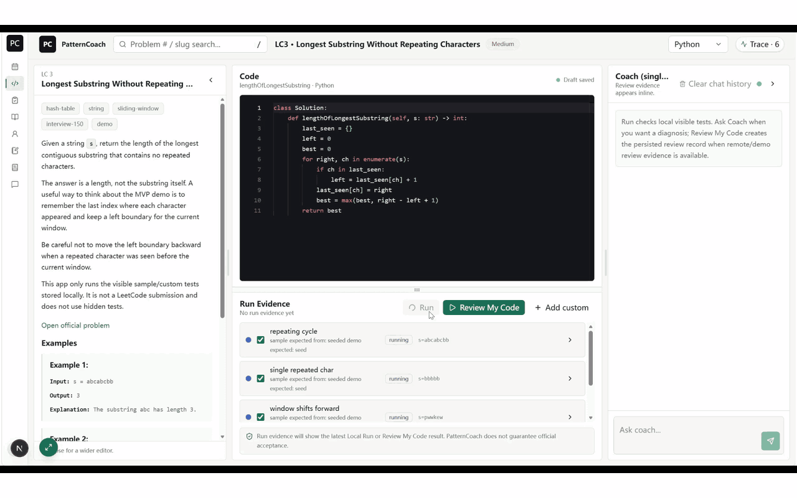
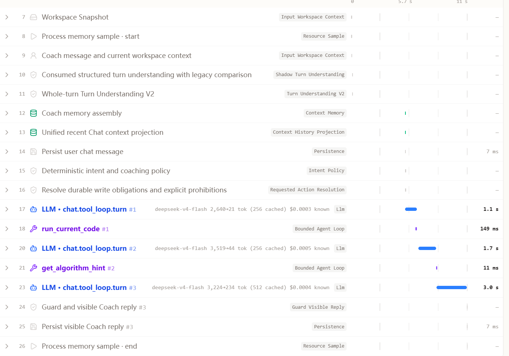
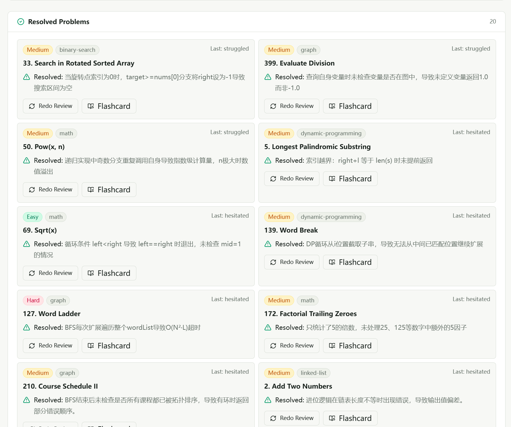
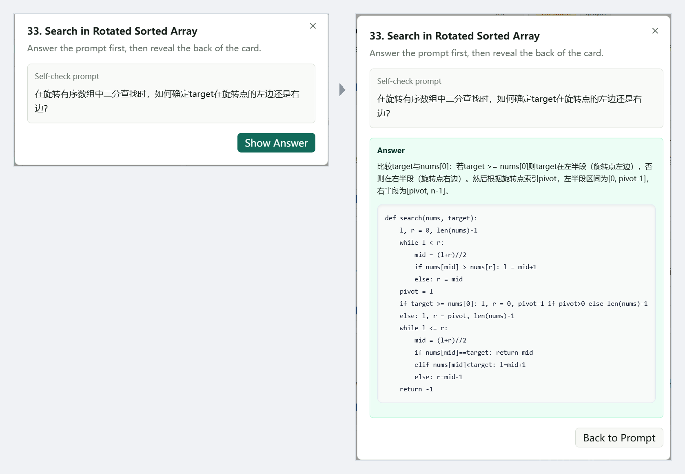
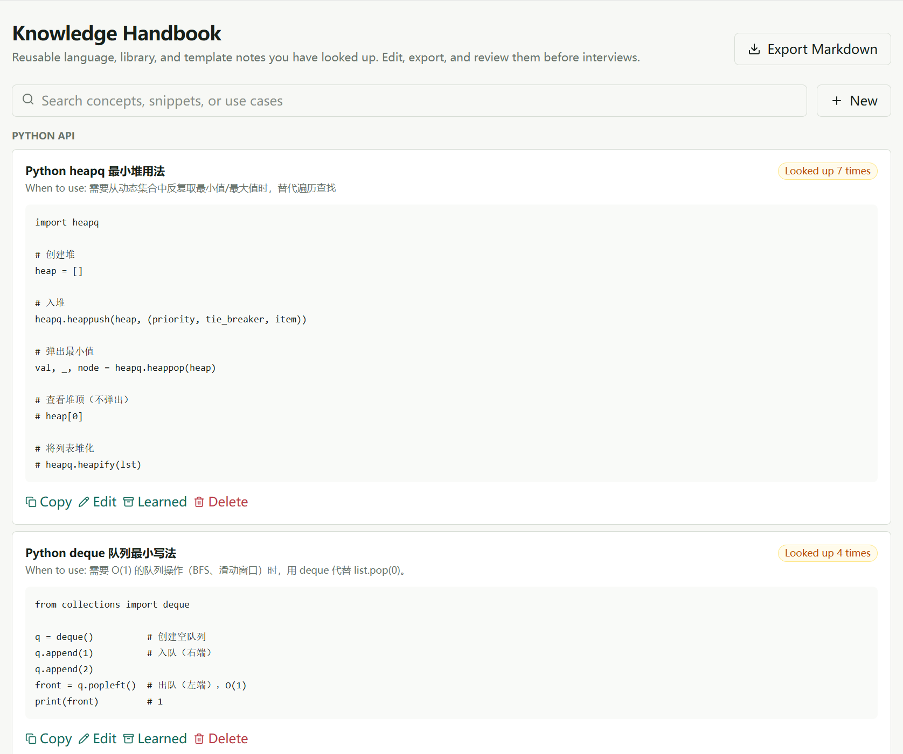
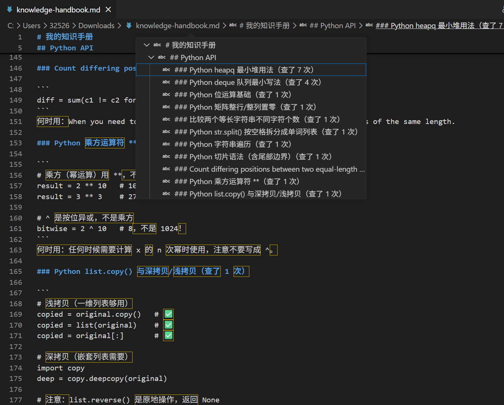
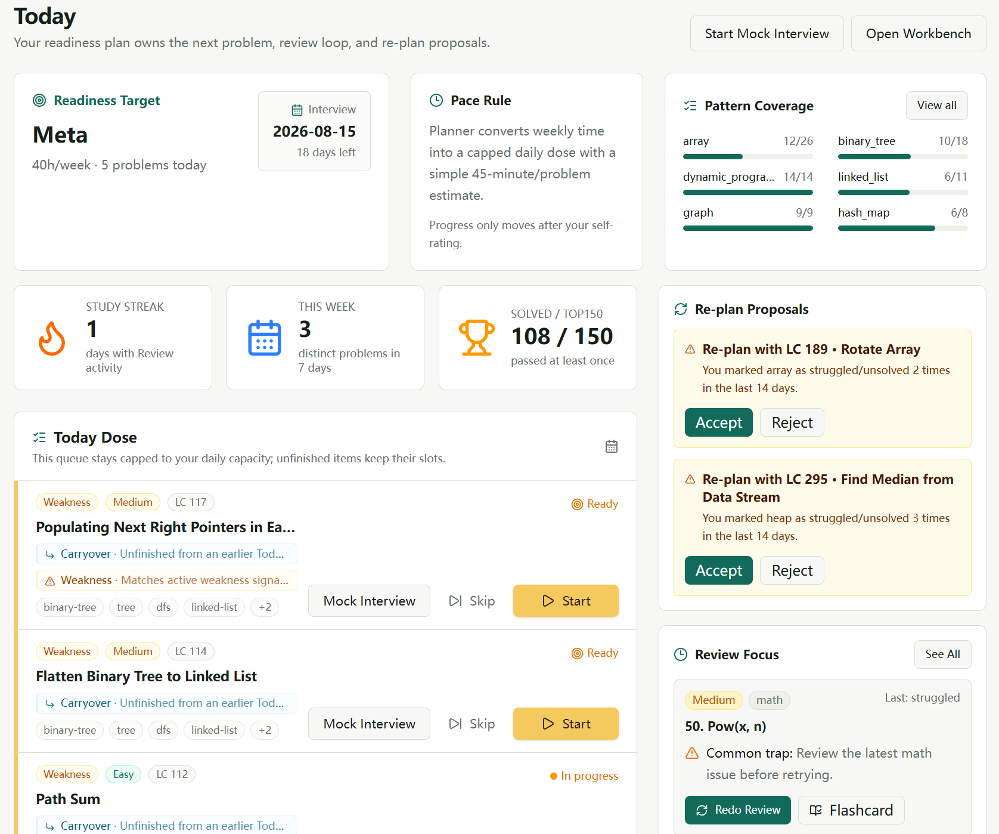
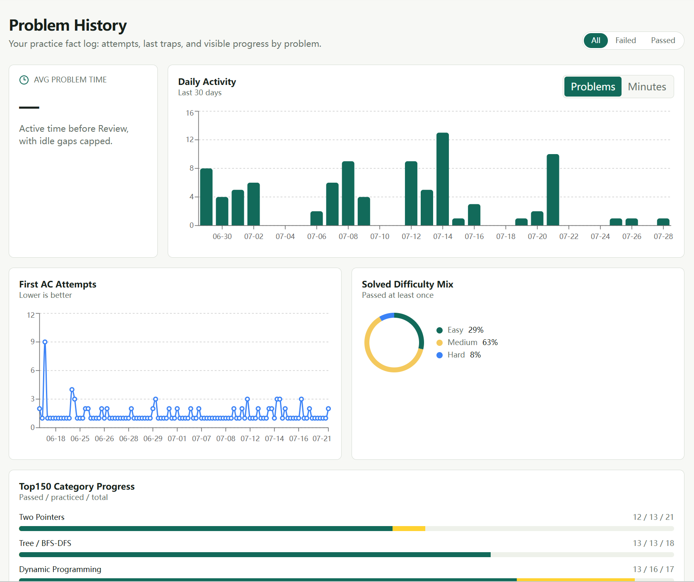
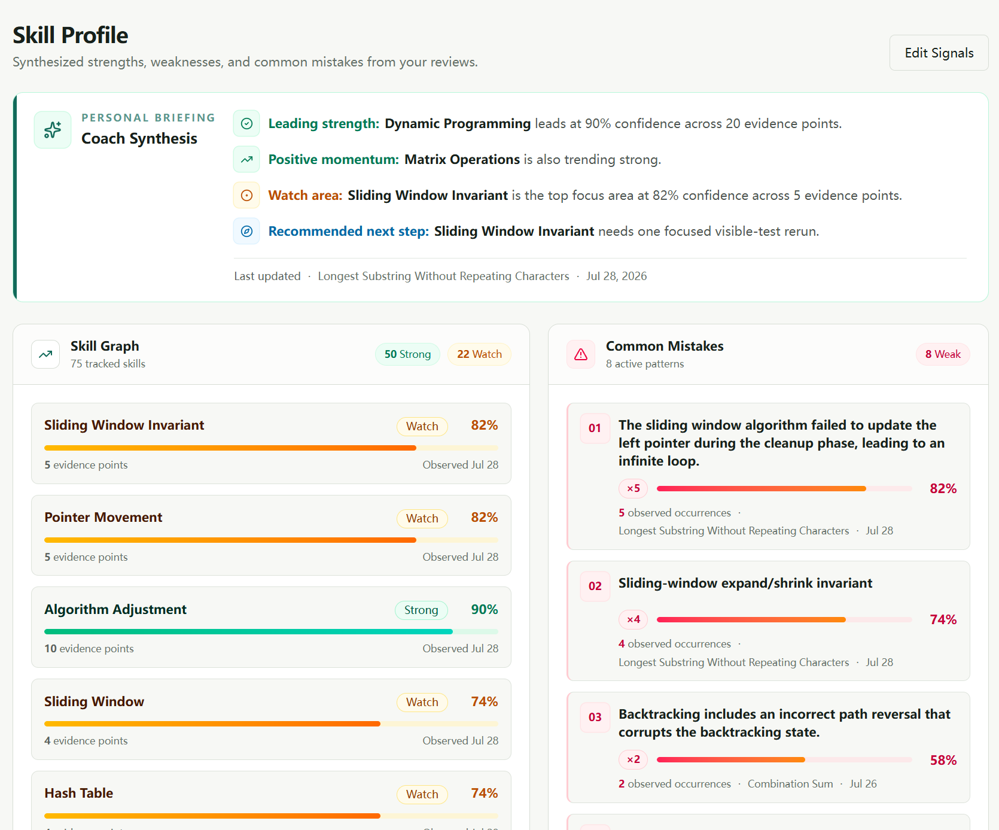

<h1 align="center">PatternCoach AI</h1>

<p align="center"><b><i>Your coding history should coach you back.</i></b></p>

<p align="center">
  A local practice workbench for the Interview-150 list.<br>
  It runs your Python, reads the actual failure, and remembers what tripped you up.
</p>

<p align="center">
  
  
  
  
  
</p>

<p align="center">
  
</p>

<p align="center">
  <a href="#-get-it-running">Get it running</a> ·
  <a href="#what-using-it-looks-like">Screenshots</a> ·
  <a href="#current-source">Current source</a> ·
  <a href="#data-and-providers">Data and providers</a>
</p>

---

## What this is

You solve a problem, get it wrong, read someone's explanation, and move on. Two weeks later you make the same mistake on a different problem and do not notice.

PatternCoach turns that loop into a local practice system that gets more useful as you use it:

- 🧠 **Learning event → stable fact → cross-problem profile.** Runs, Reviews, and chats leave an inspectable trail; repeated evidence becomes skill or mistake facts, then a living Profile that helps the Coach meet you where you are.
- ⚡ **Evidence before advice.** Piston runs your Python against the public visible tests you select **and the custom cases you add**, captures outputs and the first failure, then grounds Review in what actually happened.
- 💬 **Hints that keep you thinking.** Ask for a small next step, trace a failure, or unlock progressive hints from level 1 to 3—without being buried under an instant full solution.
- 📚 **More than a chat transcript.** Turn a recurring bug into a Mistake Book repair guide and flashcard; save reusable Python, API, and pattern notes to your Knowledge Handbook and export them as Markdown.
- 🎯 **Every next problem has a reason.** A goal-based Today plan, self-rating-driven review intervals, and Review Focus bring due work and recurring weak patterns back at the right time.
- 🔒 **Local-first, inspectable, and yours.** Your drafts, runs, history, plan, and learning artifacts stay in local SQLite. Model-powered coaching uses the providers you configure.

---

## What using it looks like

The Demo and screenshots show the earlier public release. The current source also includes Campaign planning, Mock Interview, and the Spring BFF.

### The loop



**Nothing the coach does is a black box.**
*Every model call, every tool it ran, what each one cost, how long each took. One turn, on the record.*

<br>

### What it keeps



**Your mistakes file themselves.**
*Each entry keeps the actual root cause — not "got it wrong", but which branch, which boundary, which line.*

<br>



**Then you can drill them.**
*Answer from memory first, then reveal. The prompt comes from your own failure, so it asks the thing you actually missed.*

<br>



**Notes that earn their place.**
*"Looked up 7 times" isn't a label you typed. It's how often you actually needed it.*

<br>



**And they leave with you.**
*One click, one Markdown file, headings and code fences intact. No export tier, no lock-in.*

<br>

### Where you are



**A plan you didn't have to build.**
*Target date in, daily dose out. When it notices you've stalled on a pattern it proposes a re-plan — and waits for you to accept it.*

<br>



**Progress you can't fake.**
*First-AC attempts, and passed / practiced / total per category. These move when you solve something, not when you open the app.*

<br>



**It keeps score, and it shows its work.**
*Every line carries a confidence and the number of attempts behind it. Nothing here declares you bad at something — a skill sits at **Watch** until enough evidence agrees, and each mistake pattern names the problem it came from.*

---

## ⚡ Get it running

The application now lives at the repository root. Use **Node.js 24**, **npm**, and **Docker** for local Piston code execution.

```bash
git clone https://github.com/Iriss0904/personalized-leetcode-coach.git
cd personalized-leetcode-coach
npm ci
cp .env.example .env.local
npm run db:generate
mkdir -p data
```

In `.env.local`, select a new local development database and identity:

```dotenv
DATABASE_URL="file:./data/demo.db"
PATTERNCOACH_DATABASE_PROFILE=""
PATTERNCOACH_MEMORY_ORIGIN="development"
PATTERNCOACH_LOCAL_USER_HANDLE="try"
CODE_RUNNER_PROVIDER="piston"
PISTON_URL="http://localhost:2000"
```

Configure the `LLM_CHAT_*`, `LLM_REVIEW_*`, and `LLM_MEMORY_*` provider settings from [`.env.example`](.env.example). Review can fall back to the Chat key, and Interview can fall back to the Chat provider. Model-powered features require those credentials; the earlier release's offline-coach setup does not describe this source snapshot.

Initialize that new database, start Piston, and launch the WebUI:

```bash
DATABASE_URL="file:./data/demo.db" npx prisma migrate deploy
DATABASE_URL="file:./data/demo.db" PATTERNCOACH_DATABASE_PROFILE="" \
  PATTERNCOACH_MEMORY_ORIGIN="development" PATTERNCOACH_LOCAL_USER_HANDLE="try" \
  npx tsx prisma/seed-try.ts
npm run piston:up
npm run piston:install
npx tsx scripts/dev-webui.ts
```

Open **<http://localhost:3000>**. The direct launcher above uses your `.env.local`; the `npm run dev:*` shortcuts select the original developer's predefined database profiles instead.

---

## Current source

**Practice → Prove → Adapt.** Coach captures assisted learning evidence, Mock Interview captures timed interview evidence, and the shared learner-memory system carries useful context into later practice.

| Path | Responsibility |
|---|---|
| [`app/`](app/) and [`src/features/`](src/features/) | Next.js pages and learning workflows |
| [`src/server/`](src/server/) | TypeScript agents, tools, context, memory, and application services |
| [`src/data/hot150/`](src/data/hot150/) | Hot-150 catalog and local execution contracts |
| [`backend/bff/`](backend/bff/) | Java gateway, Review streaming adapter, request coordination, and audit |
| [`prisma/`](prisma/) | SQLite schema, migrations, and seed code |
| [`compose.round1.yml`](compose.round1.yml) and [`deploy/`](deploy/) | Isolated BFF stack, routing, and monitoring configuration |

The BFF stack adds Nginx, Spring Boot, Redis, and a separate PostgreSQL audit schema around the existing Next.js/TypeScript application. Its Compose configuration uses an explicitly selected isolated data directory.

---

## Data and providers

Application records stay in the SQLite database you select; no learner database or backup is bundled in this repository. The BFF's PostgreSQL schema holds request audit records separately.

Piston executes code in a separate local service. When you enable a model provider, relevant request context, code, learning context, and tool results can be sent to that provider. Runtime Trace makes the recorded model and tool activity inspectable.

Only the public README and its Demo images are included here. Private learning notes, database files, secrets, and learner-data exports remain excluded.

---

<sub>

Licensed under **[AGPL-3.0-only](LICENSE)**. Third-party and content notices in **[NOTICE](NOTICE)**.
Code execution uses **[Engineer Man Piston](https://github.com/engineer-man/piston)**, an independent project.
LeetCode and its problem titles are third-party content and trademarks. This project is not affiliated with or endorsed by LeetCode.

</sub>
